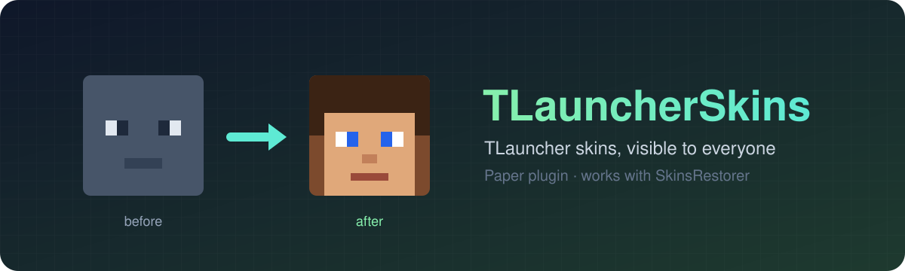
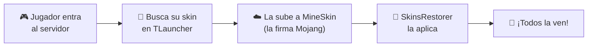

<div align="center">



<br>

[](https://github.com/Syswordd/TLauncherSkins/releases/latest)

[](https://papermc.io)
[](https://skinsrestorer.net)
[](https://adoptium.net)
[](https://github.com/Syswordd/TLauncherSkins/actions)
[](LICENSE)

**Haz que todos los jugadores de tu servidor vean las skins de TLauncher,<br>uses el launcher que uses.**

</div>

---

## 🤔 ¿Qué problema resuelve?

Tienes un servidor **no premium** (`online-mode=false`) con **SkinsRestorer**. Algunos jugadores usan **TLauncher** y otros el **launcher oficial**. Pasa esto:

| | Ve la skin del jugador de TLauncher | Ve la skin del jugador premium |
|---|:---:|:---:|
| 🟢 Jugador con **TLauncher** | ✅ | ✅ |
| 🔵 Jugador con **launcher oficial** | ❌ *(sale Steve/Alex)* | ✅ |

**Con TLauncherSkins instalado, todos ven todas las skins.** ✅✅

<details>
<summary><b>¿Por qué pasa esto?</b> (clic para ver la explicación técnica)</summary>

<br>

- **TLauncher pone las skins en el cliente.** El launcher descarga las skins de *sus propios servidores* para cada jugador que ves. Por eso, quien usa TLauncher ve todas las skins.
- **El launcher oficial solo ve lo que le manda el servidor.** Las skins de TLauncher no están en Mojang, así que nadie se las manda.
- **Minecraft rechaza skins que no estén firmadas por Mojang.** Desde hace varias versiones, el juego ignora las texturas que no estén alojadas en `textures.minecraft.net` con una firma válida. No basta con mandar el enlace de TLauncher.

</details>

---

## ⚙️ Cómo funciona



1. **Un jugador entra** al servidor.
2. El plugin **descarga su skin de TLauncher** usando su nick (y detecta si es modelo normal o *slim*).
3. La envía a **[MineSkin](https://mineskin.org)**, un servicio gratuito que la registra en Mojang y devuelve la textura **firmada**.
4. **SkinsRestorer** se la pone al jugador y la envía a todos los conectados, sin que nadie tenga que reconectarse.
5. La skin queda **guardada en caché**: solo se vuelve a subir si el jugador la cambia en TLauncher.

> [!NOTE]
> El jugador de TLauncher **no necesita cuenta premium**. MineSkin usa sus propias cuentas para firmar la skin.

---

## ✨ Características

<table>
<tr>
<td width="50%">

🔄 **Automático**<br>
Carga la skin al entrar, sin comandos.

⚡ **Caché inteligente**<br>
Solo sube la skin a MineSkin cuando cambia.

🧍 **Classic y Slim**<br>
Respeta el modelo de brazos de cada skin.

</td>
<td width="50%">

✋ **Respeta `/skin`**<br>
Si alguien se pone una skin a mano, no se la cambia.

🚫 **Lista de ignorados**<br>
Excluye a jugadores premium u otros nicks.

🪶 **Ligero**<br>
Todo se hace en segundo plano, sin lag.

</td>
</tr>
</table>

---

## 📥 Instalación

### Requisitos

| Requisito | Versión |
|---|---|
| Servidor | **Paper** 26.x (o forks como Purpur) |
| Java | **25** o superior |
| Plugin necesario | **[SkinsRestorer](https://modrinth.com/plugin/skinsrestorer)** v15 |

### Pasos

1. **[Descarga el `.jar`](https://github.com/Syswordd/TLauncherSkins/releases/latest)** desde la última release.
2. Cópialo en la carpeta **`plugins/`** de tu servidor, junto a SkinsRestorer.
3. **Reinicia** el servidor.
4. *(Recomendado)* Abre `plugins/TLauncherSkins/config.yml` y añade a **`ignorar-jugadores`** los nicks de los jugadores **premium**.

¡Listo! 🎉 La próxima vez que entre un jugador con TLauncher, todos verán su skin.

> [!IMPORTANT]
> El **nick en el servidor** tiene que ser **el mismo** que el de la cuenta de TLauncher. Si no coincide, no se encontrará la skin.

---

## 💬 Comandos y permisos

| Comando | Qué hace | Permiso | Por defecto |
|---|---|---|---|
| `/tlskin` | Vuelve a cargar **tu** skin de TLauncher | `tlskin.use` | Todos |
| `/tlskin <jugador>` | Vuelve a cargar la skin de **otro** jugador | `tlskin.admin` | OP |

> [!TIP]
> ¿Te has cambiado la skin en TLauncher? Escribe `/tlskin` y se actualiza al momento, sin reconectar.

---

## 🛠️ Configuración

Archivo `plugins/TLauncherSkins/config.yml`:

```yaml
# Dirección que devuelve los datos de la skin de un nick en TLauncher.
# {name} se sustituye por el nick del jugador.
perfil-url: "https://auth.tlauncher.org/skin/profile/texture/login/{name}"

# Si la dirección anterior falla, se intenta descargar la imagen directamente.
skin-url: "https://auth.tlauncher.org/skin/fileservice/skins/skin_{name}.png"

# Si un jugador se ha puesto una skin a mano con /skin, no se la cambiamos.
respetar-skin-manual: true

# Nicks a los que nunca se les buscará skin en TLauncher (por ejemplo, jugadores premium).
ignorar-jugadores: []

# Mostrar en consola lo que hace el plugin con cada jugador.
debug: false
```

| Opción | Descripción |
|---|---|
| `perfil-url` | Dónde consultar la skin de un nick en TLauncher. |
| `skin-url` | Imagen de la skin, por si la consulta anterior falla. |
| `respetar-skin-manual` | `true` = no toca a quien se puso skin con `/skin`. |
| `ignorar-jugadores` | Lista de nicks que el plugin ignora. Ej: `["MiNickPremium", "Otro"]` |
| `debug` | `true` = muestra en consola qué hace con cada jugador. |

---

## ❓ Preguntas frecuentes

<details>
<summary><b>Mi amigo sigue saliendo con la skin por defecto</b></summary>

<br>

1. Pon `debug: true` en el `config.yml` y reinicia.
2. Haz que tu amigo entre al servidor y mira la consola:
   - **"no tiene skin en TLauncher"** → su nick del servidor no coincide con el de TLauncher, o no tiene skin subida.
   - **"tiene una skin puesta a mano"** → usó `/skin`. Que escriba `/skin clear` o usa `/tlskin <nick>`.
   - **Error de conexión** → tu servidor no puede conectarse a `auth.tlauncher.org` o a MineSkin (firewall o DNS del hosting).

</details>

<details>
<summary><b>¿Por qué debería ignorar a los jugadores premium?</b></summary>

<br>

Si alguien en TLauncher tiene registrado **el mismo nick** que un jugador premium, el plugin le pondría la skin de TLauncher en vez de la de Mojang. Añadiendo los nicks premium a `ignorar-jugadores` lo evitas.

</details>

<details>
<summary><b>¿Funciona en Spigot, Velocity o BungeeCord?</b></summary>

<br>

Está pensado para **Paper**. En Spigot debería funcionar, porque solo usa la API básica de Bukkit. Para redes con proxy (Velocity/BungeeCord), instálalo en cada servidor Paper donde esté SkinsRestorer.

</details>

<details>
<summary><b>¿Tiene límite de uso MineSkin?</b></summary>

<br>

MineSkin tiene un límite de peticiones por minuto. El plugin guarda en caché cada skin y solo la vuelve a subir si cambia, así que en servidores normales no es un problema.

</details>

---

## 🧑‍💻 Compilar desde el código

Necesitas **JDK 25** y **Maven**:

```bash
git clone https://github.com/Syswordd/TLauncherSkins.git
cd TLauncherSkins
mvn package
```

El plugin aparecerá en `target/TLauncherSkins-<versión>.jar`.

---

<div align="center">

Hecho con ❤️ para servidores con amigos de TLauncher

<sub>Este proyecto no está afiliado con TLauncher, Mojang ni Microsoft.</sub>

</div>
