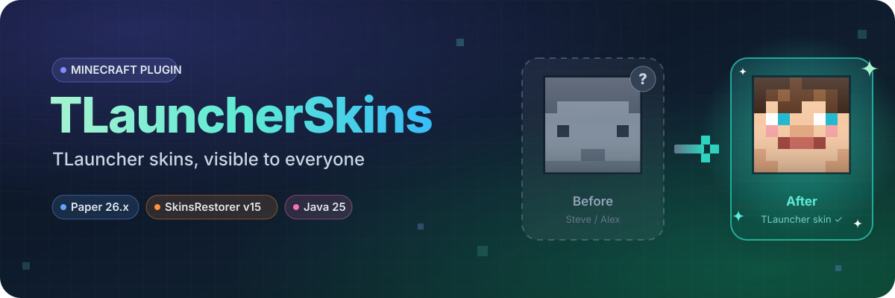
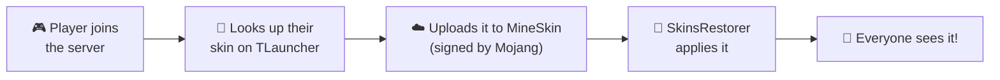

<div align="center">



<sub>🌐 <b>English</b> · <a href="README.es.md">Español</a></sub>

<br><br>

[](https://github.com/Syswordd/TLauncherSkins/releases/latest)

[](https://papermc.io)
[](https://skinsrestorer.net)
[](https://adoptium.net)
[](https://github.com/Syswordd/TLauncherSkins/actions)
[](LICENSE)

**Let every player on your server see TLauncher skins,<br>no matter which launcher they use.**

</div>

---

## 🤔 What problem does it solve?

You run a **cracked / offline-mode** server (`online-mode=false`) with **SkinsRestorer**. Some players use **TLauncher** and others use the **official launcher**. This happens:

| | Sees the TLauncher player's skin | Sees the premium player's skin |
|---|:---:|:---:|
| 🟢 Player on **TLauncher** | ✅ | ✅ |
| 🔵 Player on the **official launcher** | ❌ *(shows Steve/Alex)* | ✅ |

**With TLauncherSkins installed, everyone sees every skin.** ✅✅

<details>
<summary><b>Why does this happen?</b> (click for the technical explanation)</summary>

<br>

- **TLauncher adds skins on the client side.** The launcher downloads skins from *its own servers* for every player you see. That's why TLauncher users see all skins.
- **The official launcher only sees what the server sends.** TLauncher skins aren't on Mojang's servers, so nobody sends them.
- **Minecraft rejects skins that aren't signed by Mojang.** For several versions now, the game ignores textures that aren't hosted on `textures.minecraft.net` with a valid signature. Sending the TLauncher link isn't enough.

</details>

---

## ⚙️ How it works



1. **A player joins** the server.
2. The plugin **downloads their TLauncher skin** using their nickname (and detects whether it's a classic or *slim* model).
3. It sends it to **[MineSkin](https://mineskin.org)**, a free service that registers it with Mojang and returns a **signed** texture.
4. **SkinsRestorer** applies it to the player and sends it to everyone online, no reconnecting needed.
5. The skin is **cached**: it's only uploaded again if the player changes it on TLauncher.

> [!NOTE]
> The TLauncher player **doesn't need a premium account**. MineSkin uses its own accounts to sign the skin.

---

## ✨ Features

<table>
<tr>
<td width="50%">

🔄 **Automatic**<br>
Loads the skin on join, no commands needed.

⚡ **Smart cache**<br>
Only uploads to MineSkin when the skin changes.

🧍 **Classic and Slim**<br>
Keeps each skin's arm model.

</td>
<td width="50%">

✋ **Respects `/skin`**<br>
If someone sets a skin manually, it stays.

🚫 **Ignore list**<br>
Exclude premium players or any nickname.

🪶 **Lightweight**<br>
Everything runs in the background, no lag.

</td>
</tr>
</table>

---

## 📥 Installation

### Requirements

| Requirement | Version |
|---|---|
| Server | **Paper** 26.x (or forks like Purpur) |
| Java | **25** or newer |
| Required plugin | **[SkinsRestorer](https://modrinth.com/plugin/skinsrestorer)** v15 |

### Steps

1. **[Download the `.jar`](https://github.com/Syswordd/TLauncherSkins/releases/latest)** from the latest release.
2. Put it in your server's **`plugins/`** folder, next to SkinsRestorer.
3. **Restart** the server.
4. *(Recommended)* Open `plugins/TLauncherSkins/config.yml` and add your **premium** players' nicknames to **`ignored-players`**.

Done! 🎉 Next time a TLauncher player joins, everyone will see their skin.

> [!IMPORTANT]
> The **nickname on the server** must be **the same** as the TLauncher account's nickname. If they don't match, the skin won't be found.

---

## 💬 Commands and permissions

| Command | What it does | Permission | Default |
|---|---|---|---|
| `/tlskin` | Reloads **your** TLauncher skin | `tlskin.use` | Everyone |
| `/tlskin <player>` | Reloads **another** player's skin | `tlskin.admin` | OP |

> [!TIP]
> Changed your skin on TLauncher? Type `/tlskin` and it updates instantly, no reconnecting.

---

## 🛠️ Configuration

File `plugins/TLauncherSkins/config.yml`:

```yaml
# URL that returns the skin data of a nickname on TLauncher.
# {name} is replaced with the player's nickname.
profile-url: "https://auth.tlauncher.org/skin/profile/texture/login/{name}"

# If the URL above fails, the image is downloaded directly from here.
skin-url: "https://auth.tlauncher.org/skin/fileservice/skins/skin_{name}.png"

# If a player has set a skin manually with /skin, leave it alone.
respect-manual-skin: true

# Nicknames that will never be looked up on TLauncher (for example, premium players).
ignored-players: []

# Log what the plugin does with each player to the console.
debug: false
```

| Option | Description |
|---|---|
| `profile-url` | Where to look up a nickname's skin on TLauncher. |
| `skin-url` | The skin image, used if the lookup above fails. |
| `respect-manual-skin` | `true` = don't touch players who set a skin with `/skin`. |
| `ignored-players` | Nicknames the plugin ignores. E.g. `["MyPremiumNick", "Other"]` |
| `debug` | `true` = log what happens with each player to the console. |

---

## ❓ FAQ

<details>
<summary><b>My friend still shows up with the default skin</b></summary>

<br>

1. Set `debug: true` in `config.yml` and restart.
2. Have your friend join and check the console:
   - **"has no skin on TLauncher"** → their server nickname doesn't match their TLauncher one, or they have no skin uploaded.
   - **"has a manually set skin"** → they used `/skin`. Have them run `/skin clear`, or use `/tlskin <nick>`.
   - **Connection error** → your server can't reach `auth.tlauncher.org` or MineSkin (hosting firewall or DNS).

</details>

<details>
<summary><b>Why should I ignore premium players?</b></summary>

<br>

If someone on TLauncher has registered **the same nickname** as a premium player, the plugin would give that player the TLauncher skin instead of their Mojang one. Adding premium nicknames to `ignored-players` prevents this.

</details>

<details>
<summary><b>Does it work on Spigot, Velocity or BungeeCord?</b></summary>

<br>

It's built for **Paper**. It should work on Spigot, since it only uses the basic Bukkit API. For proxy networks (Velocity/BungeeCord), install it on every Paper server that has SkinsRestorer.

</details>

<details>
<summary><b>Does MineSkin have a usage limit?</b></summary>

<br>

MineSkin has a requests-per-minute limit. The plugin caches every skin and only re-uploads it when it changes, so it's not a problem on normal servers.

</details>

---

## 🧑‍💻 Building from source

You need **JDK 25** and **Maven**:

```bash
git clone https://github.com/Syswordd/TLauncherSkins.git
cd TLauncherSkins
mvn package
```

The plugin will be at `target/TLauncherSkins-<version>.jar`.

---

<div align="center">

Made with ❤️ for servers with TLauncher friends

<sub>This project is not affiliated with TLauncher, Mojang or Microsoft.</sub>

</div>
